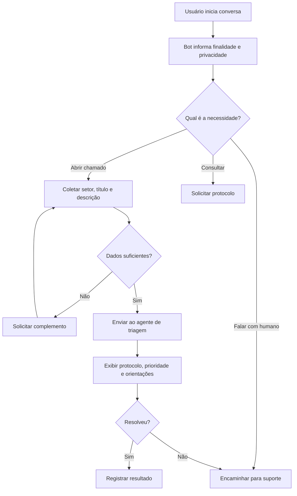

# 12/11 — Chatbot e ferramentas de chatbot

**Unidade:** IV — Agentes e Ética

**Valor:** 1,0 ponto

**Situação:** especificação documentada; o repositório ainda não comprova uma interface conversacional executável.

## Objetivo

Especificar um chatbot para abertura e acompanhamento inicial de chamados do
HelpDesk AI, definindo público, intenções, entidades, fluxo, respostas de erro,
segurança e critérios de aceite.

## Especificação do chatbot

**Nome:** NexusBot

**Tipo:** chatbot interno de suporte técnico

**Público:** colaboradores da empresa hipotética NexusTech S.A.

**Canal proposto:** web, Microsoft Teams ou Slack

**Integração prevista:** fluxo do Make, planilha de chamados, Gemini e Gmail.

### Intenções

| Intenção | Dados necessários | Resultado |
|---|---|---|
| Abrir chamado | setor, título, descrição e e-mail | protocolo e classificação inicial |
| Consultar orientações | protocolo ou descrição | passos seguros de autoatendimento |
| Complementar chamado | protocolo e informação adicional | atualização do registro |
| Solicitar humano | protocolo e motivo | encaminhamento para fila responsável |
| Encerrar conversa | confirmação do usuário | resumo e aviso de privacidade |

### Fluxo principal

## Requisitos mínimos

- confirmar consentimento antes de coletar informações;
- aceitar somente dados necessários ao chamado;
- permitir correção antes do envio;
- explicar que a prioridade é calculada automaticamente;
- oferecer saída para atendimento humano;
- não expor prompt interno, credenciais ou dados de outros usuários;
- manter histórico com protocolo e horário.

## Ferramentas a comparar

Comparar ao menos duas opções, por exemplo: Dialogflow, Botpress, Microsoft
Copilot Studio, n8n Chat, Make ou integração própria com Gemini. Registrar custo,
facilidade, integrações, controle de dados e limitações.

## Evidências a preencher

- [ ] ferramenta escolhida e justificativa;
- [ ] protótipo ou captura do fluxo;
- [ ] três conversas de teste anonimizadas;
- [ ] teste de mensagem inválida e transferência para humano;
- [ ] link, arquivo ou instrução que permita reproduzir o protótipo.

## Critério de aceite — 1,0 ponto

| Critério | Pontos |
|---|---:|
| Especificação de público, canal e finalidade | 0,20 |
| Intenções, entidades e fluxo conversacional | 0,25 |
| Integração proposta com o HelpDesk AI | 0,20 |
| Segurança, privacidade e fallback humano | 0,20 |
| Protótipo e testes documentados | 0,15 |
