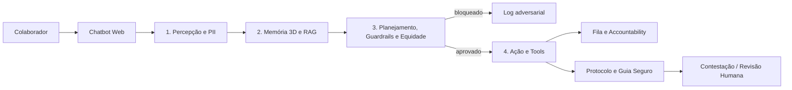

# Documentação acadêmica — HelpDesk AI 2.0

Atualização baseada no commit
[`8dde18f`](https://github.com/sztsu/helpdesk-ai/commit/8dde18f), consultado em
25/11/2026.

## 1. Identificação

| Item | Definição |
|---|---|
| Sistema | HelpDesk AI 2.0 — Chatbot e Agente Autônomo de Triagem ITSM |
| Cenário | empresa hipotética NexusTech S.A. |
| Tipo | aplicação web zero-build + agente local + integração Low/No Code em nuvem |
| Público | colaboradores, suporte N1/N2, gestores e auditores |
| Estágio | protótipo acadêmico funcional; não homologado para produção |
| Repositório-fonte | <https://github.com/sztsu/helpdesk-ai> |
| Aplicação | <https://sztsu.github.io/helpdesk-ai/> |

### Autoria e participação

| Integrante | Participação documentada |
|---|---|
| Gustavo Negreiros | concepção e implementação da esteira v1.x e da aplicação v2.0, agente, interface, testes e documentação técnica |
| João Pedro Alves | integração do projeto no repositório da disciplina, análise dos artefatos, atividades da Unidade 4, reflexão ética e roteiro acadêmico |

## 2. Problema e objetivo

Uma fila única de suporte não considera o impacto de cada setor, permite urgência
subjetiva e exige que o Nível 1 faça triagem manual. Um chatbot ingênuo acrescenta
riscos de vazamento de dados, alucinação, prompt injection e decisões sem direito
de contestação.

O sistema recebe o relato em linguagem natural e busca:

1. proteger dados pessoais antes de memória ou rede;
2. compreender o incidente em diálogo multi-turno;
3. recuperar um manual interno por RAG;
4. classificar categoria, prioridade, SLA e fila;
5. gerar até três orientações seguras;
6. registrar protocolo e trilha de auditoria;
7. manter fallback em falha da API externa;
8. permitir contestação e revisão humana.

## 3. Evolução do projeto

| Versão | Arquitetura | Resultado |
|---|---|---|
| v1.x | Forms → Sheets → Make → Gemini → Gmail | triagem assíncrona e e-mail de autoatendimento |
| v2.0 | Chatbot → Agente 4 camadas → RAG/Tools → Fila/Auditoria | interação em tempo real, privacidade, equidade e testes no navegador |

O snapshot histórico v1.x está preservado na
[Unidade 3](../../../Unidade_03/10_Outubro/29_10_Limitacoes_e_Mini_Projeto/HelpDeskAI/).

## 4. Escopo

### Incluído na versão 2.0

- interface web responsiva em HTML, CSS e JavaScript;
- motor local determinístico, com conexão opcional ao Gemini 2.5 Flash;
- quatro camadas visíveis de percepção, memória, planejamento e ação;
- memória de curto, médio e longo prazo;
- seis referências internas de conhecimento RAG;
- mascaramento de CPF, senha, cartão, API key e e-mail pessoal;
- guardrails de prompt injection, personificação e pedidos destrutivos;
- criação e consulta de protocolo;
- fila operacional, aging, contestação humana e backup JSON;
- fallback local em HTTP 503/429;
- suíte executável de 24 testes;
- manutenção da esteira Low/No Code v1.x como integração paralela.

### Fora do escopo

- autenticação SSO e controle corporativo de perfis;
- backend e banco relacional produtivos;
- integração bidirecional homologada com Jira ou ServiceNow;
- execução remota de comandos administrativos;
- atendimento humano ao vivo dentro da interface;
- SLA contratual, alta disponibilidade ou uso de dados reais.

## 5. Arquitetura do agente



### Camada 1 — Percepção e Privacy by Design

`perceiveAndSanitize()` identifica dados pessoais e substitui o conteúdo por
marcadores antes de persistência ou chamada externa.

### Camada 2 — Memória em três dimensões

| Dimensão | Implementação | Finalidade |
|---|---|---|
| curto prazo | últimos turnos e esclarecimento pendente | completar relatos vagos |
| médio prazo | tickets sanitizados em `localStorage` | histórico e reincidência |
| longo prazo | `KNOWLEDGE_BASE` com seis manuais | ancorar orientações em RAG |

### Camada 3 — Planejamento, segurança e equidade

Interpreta a intenção, aplica guardrails e calcula uma decisão que combina setor,
gravidade técnica, urgência, reincidência e aging. Tom hostil não reduz prioridade.

### Camada 4 — Ação e ferramentas

| Tool | Resultado auditável |
|---|---|
| `sanitize_pii` | texto sanitizado e tipos removidos |
| `search_knowledge_base` | referência `KB-XXX` e termos correspondentes |
| `evaluate_business_sla` | prioridade, SLA e fila |
| `create_ticket` | protocolo `HD-2026-XXX` |
| `query_ticket_status` | estado do protocolo |
| `request_clarification` | pergunta objetiva sem criar ticket |
| `activate_fallback_contingency` | motor local em falha da API |

## 6. Regras de negócio

1. Prioridade combina setor, impacto, urgência e tipo de incidente.
2. Relato insuficiente gera esclarecimento, não diagnóstico inventado.
3. Orientações devem vir de manual RAG e ter no máximo três passos seguros.
4. PII deve ser removida antes de memória persistente ou rede.
5. Prompt injection e comandos destrutivos não criam ticket.
6. Reincidência pode promover chamados P3/P4 e reduzir o SLA.
7. Aging evita que áreas administrativas fiquem indefinidamente sem atendimento.
8. Toda decisão deve ter justificativa, referência e log.
9. O usuário pode contestar a classificação e solicitar humano.
10. Falha externa deve acionar contingência, sem perder o relato.

## 7. Requisitos funcionais

| ID | Requisito |
|---|---|
| RF-01 | atender por chat em linguagem natural |
| RF-02 | mascarar PII automaticamente |
| RF-03 | pedir esclarecimento em diálogo multi-turno |
| RF-04 | recuperar conteúdo da base RAG |
| RF-05 | classificar categoria, prioridade, SLA e fila |
| RF-06 | criar e consultar protocolo |
| RF-07 | bloquear pedidos adversariais e destrutivos |
| RF-08 | exibir telemetria das quatro camadas |
| RF-09 | gerenciar fila, aging e backup JSON |
| RF-10 | permitir contestação humana |
| RF-11 | apagar memória local por solicitação do usuário |
| RF-12 | executar 24 testes no navegador |

## 8. Requisitos não funcionais

| ID | Categoria | Critério acadêmico |
|---|---|---|
| RNF-01 | desempenho | motor local responde em milissegundos; carga < 500 ms |
| RNF-02 | segurança | zero execução destrutiva e zero segredo versionado |
| RNF-03 | privacidade | PII mascarada antes de persistência ou rede |
| RNF-04 | resiliência | fallback em HTTP 503/429 |
| RNF-05 | auditabilidade | tools, decisão, horário e remediação registrados |
| RNF-06 | portabilidade | execução zero-build em navegador moderno |
| RNF-07 | usabilidade | linguagem simples, protocolo e guia objetivo |
| RNF-08 | manutenibilidade | regras, testes e versões documentados no Git |

## 9. Dados principais

| Campo | Finalidade |
|---|---|
| `id` | protocolo único |
| `createdAt` | data e hora |
| `collaborator` | solicitante da demonstração |
| `sectorId` | setor corporativo |
| `summary` | relato já sanitizado |
| `category` | categoria técnica |
| `priority` | P1 a P4 |
| `slaMinutes` | SLA calculado |
| `queue` | fila humana responsável |
| `kbRef` | manual RAG utilizado |
| `status` | estado do chamado |
| `contested` | contestação humana acionada |

## 10. Privacidade, viés e responsabilidade

- textos são sanitizados antes de serem gravados;
- API key opcional permanece em `sessionStorage`;
- botão **Limpar Memória (LGPD)** permite exclusão local;
- linguagem informal e tom hostil possuem testes próprios;
- nomes diferentes com relato idêntico devem gerar a mesma decisão;
- reincidência e aging mitigam inanição de setores de menor peso;
- contestação garante remediação humana;
- a fila N1/N2 continua responsável pelo resultado final.

## 11. Testes

A referência canônica é a suíte `TC-01` a `TC-24` implementada em
`HelpDeskAgent.runAutomatedTestSuite()` e descrita em
[`docs/06_testes_manutencao_changelog.md`](https://github.com/sztsu/helpdesk-ai/blob/main/docs/06_testes_manutencao_changelog.md).

| Grupo | Casos | Cobertura |
|---|---|---|
| funcional | TC-01 a TC-06 | cinco setores e consulta de protocolo |
| viés | TC-07, TC-08 e TC-19 a TC-21 | linguagem, tom, gênero, reincidência e aging |
| adversarial | TC-09 a TC-13 | prompt injection e comandos destrutivos |
| privacidade | TC-14 a TC-16 | CPF, senha, API key, e-mail e cartão |
| resiliência | TC-17 e TC-24 | HTTP 503 e rajada de 30 chamados |
| diálogo | TC-18 e TC-23 | relato vago e dois turnos |
| remediação | TC-22 | contestação e log humano |

O repositório-fonte apresenta evidência visual de **24/24 casos aprovados**. Esse
resultado pertence à execução registrada pelo projeto e pode ser reproduzido na
aba **Testes Adversariais & Stress**.

## 12. Execução

### Pela web

1. abrir <https://sztsu.github.io/helpdesk-ai/>;
2. selecionar nome e setor fictícios;
3. usar um cenário rápido ou digitar o incidente;
4. observar a telemetria das quatro camadas;
5. executar a suíte completa na aba de testes.

### Localmente

```bash
git clone https://github.com/sztsu/helpdesk-ai.git
cd helpdesk-ai
start index.html
```

Não é necessário build. Para evitar limitações de `file://`, também é possível
servir a pasta com `python -m http.server 8080`.

## 13. Operação e contingência

- API Gemini indisponível: ativar motor local + RAG e registrar fallback;
- entrada com PII: mascarar e recomendar troca de senha exposta;
- decisão contestada: mover para revisão humana;
- memória local: permitir exclusão e exportação JSON;
- evolução futura: backend autenticado, banco relacional, RBAC, monitoramento e
  integração ITSM corporativa.

## 14. Limitações

O protótipo não comprova segurança, desempenho ou justiça em produção. Os 24 casos
são uma suíte controlada e não substituem avaliação contínua com amostras reais,
revisão jurídica, teste de acessibilidade, pentest, homologação e monitoramento de
drift. A persistência no navegador também não é apropriada para dados corporativos
reais sem controles adicionais.

## 15. Referências do projeto

- [README e portal técnico](https://github.com/sztsu/helpdesk-ai)
- [Arquitetura, dados e APIs](https://github.com/sztsu/helpdesk-ai/blob/main/docs/03_arquitetura_agente_e_dados.md)
- [Ética, vieses e governança](https://github.com/sztsu/helpdesk-ai/blob/main/docs/04_etica_vieses_e_governanca.md)
- [Testes e manutenção](https://github.com/sztsu/helpdesk-ai/blob/main/docs/06_testes_manutencao_changelog.md)
- [Guia do usuário](https://github.com/sztsu/helpdesk-ai/blob/main/docs/07_guia_do_usuario_faq.md)
- [Registro local de fontes e autoria](../../REFERENCIAS_HELPDESK_AI_2_0.md)
