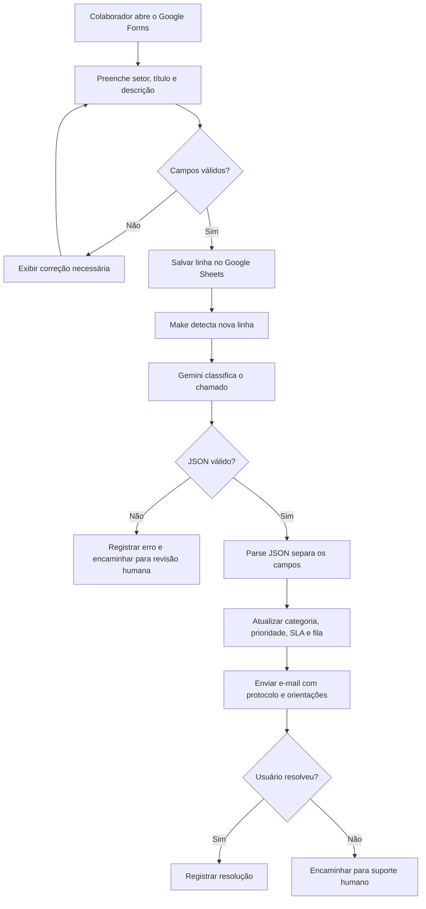
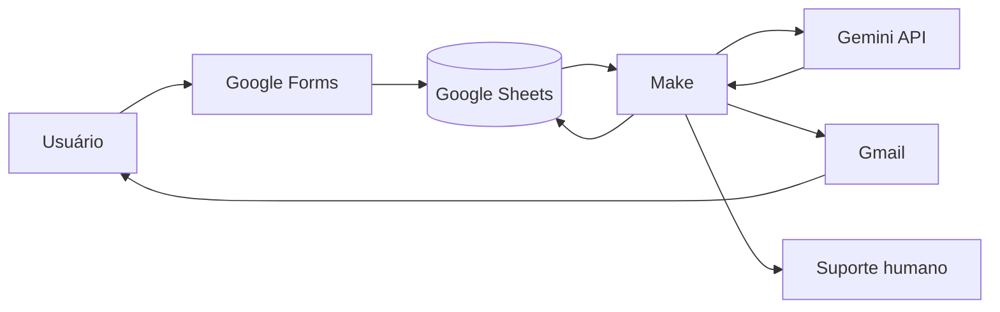
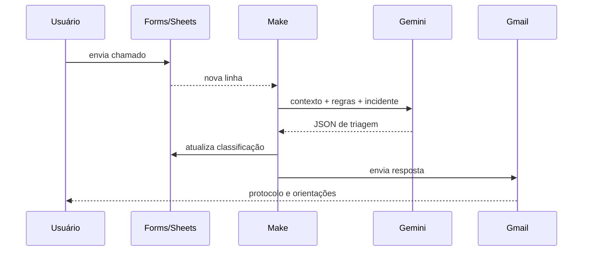

# Documentação do sistema — HelpDesk AI

## Identificação

| Item | Definição |
|---|---|
| Tipo de sistema | Sistema interno web e automação Low Code/No Code orientada a eventos |
| Público principal | Colaboradores, equipe de suporte e gestores de TI |
| Estágio | Protótipo acadêmico funcional; não homologado para produção |
| Cenário | Empresa hipotética NexusTech S.A. |
| Autores | Gustavo Negreiros e João Pedro Alves |

## 1. Visão geral e escopo

### Objetivo

O HelpDesk AI reduz a triagem manual de chamados. Ele recebe um relato de
incidente, considera o setor do solicitante, classifica categoria e prioridade,
estima SLA, seleciona a fila técnica e envia orientações iniciais por e-mail.

### Público-alvo

- colaboradores que precisam registrar problemas de TI;
- suporte Nível 1, que recebe dados estruturados;
- equipes de Infraestrutura e Sistemas;
- gestores que acompanham prioridade e SLA.

### Dentro do escopo atual

- abertura por Google Forms;
- armazenamento em Google Sheets;
- orquestração no Make;
- classificação com Gemini;
- saída JSON estruturada;
- atualização da planilha;
- envio de e-mail pelo Gmail;
- regras de prioridade por setor;
- evidências visuais e apresentação acadêmica.

### Fora do escopo atual

- chatbot conversacional executável;
- aplicativo mobile nativo;
- autenticação corporativa própria;
- banco relacional e API REST próprios;
- execução remota de comandos;
- fechamento automático do chamado;
- painel de métricas em tempo real;
- SLA contratual ou disponibilidade de produção.

## 2. Regras de negócio

1. Todo chamado deve conter nome, e-mail, setor, título e descrição.
2. A prioridade considera impacto do setor, urgência e natureza do incidente.
3. Segurança e indisponibilidade crítica devem ser escaladas para humano.
4. P1 representa impacto crítico; P4 representa baixo impacto.
5. O agente pode orientar, mas não executar ações na máquina do usuário.
6. Orientações devem ter no máximo três passos seguros.
7. Descrições insuficientes exigem complemento, sem diagnóstico inventado.
8. Credenciais, segredos e dados pessoais desnecessários não devem ser coletados.
9. A decisão deve registrar categoria, prioridade, SLA, fila e justificativa.
10. O usuário deve poder solicitar atendimento humano.

### Matriz resumida

| Setor | Impacto-base | Faixa usual |
|---|---|---|
| Operações/NOC | altíssimo | P1–P2 |
| Financeiro | alto | P1–P2 |
| Engenharia | médio/alto | P2–P3 |
| Comercial/CX | médio | P2–P3 |
| RH/Administrativo | baixo/moderado | P3–P4 |

A matriz não substitui a análise do incidente: uma violação de segurança em RH,
por exemplo, pode exigir prioridade elevada.

## 3. Requisitos funcionais

| ID | Requisito |
|---|---|
| RF01 | Permitir abertura de chamado com campos obrigatórios |
| RF02 | Validar formato de e-mail e setor permitido |
| RF03 | Registrar a submissão em uma linha da planilha |
| RF04 | Detectar automaticamente novas linhas |
| RF05 | Enviar os dados necessários ao modelo de IA |
| RF06 | Classificar categoria, prioridade, SLA e fila |
| RF07 | Validar e deserializar a resposta JSON |
| RF08 | Atualizar a linha original com o resultado |
| RF09 | Enviar e-mail de confirmação e autoatendimento |
| RF10 | Registrar falhas para reprocessamento manual |

### Histórias de usuário

- Como colaborador, quero abrir um chamado simples para receber protocolo e orientação.
- Como analista, quero receber chamados classificados para reduzir a triagem manual.
- Como gestor, quero visualizar prioridade e SLA para acompanhar riscos.
- Como usuário, quero solicitar atendimento humano quando a orientação não resolver.

## 4. Requisitos não funcionais

| ID | Categoria | Critério |
|---|---|---|
| RNF01 | Desempenho | resposta-alvo inferior a 1 minuto em condição normal |
| RNF02 | Segurança | credenciais somente nos cofres das plataformas |
| RNF03 | Privacidade | minimização e anonimização de dados enviados à IA |
| RNF04 | Disponibilidade | falha externa não pode apagar a submissão original |
| RNF05 | Auditabilidade | entrada, saída e horário devem permanecer registrados |
| RNF06 | Usabilidade | formulário compreensível por usuário não técnico |
| RNF07 | Escalabilidade | limites de Make/Gemini devem ser monitorados |
| RNF08 | Manutenibilidade | prompt, regras e campos devem ter versão documentada |

## 5. Fluxos e protótipo

### Fluxograma principal



### Jornada do usuário

1. acessa o formulário;
2. informa dados mínimos e descreve o incidente;
3. recebe confirmação;
4. aguarda a classificação automática;
5. recebe e-mail com prioridade, SLA e passos seguros;
6. tenta a orientação ou procura suporte humano.

O protótipo visual está evidenciado nas imagens do
[projeto original](../../../Unidade_03/10_Outubro/29_10_Limitacoes_e_Mini_Projeto/HelpDeskAI/docs/images/).

## 6. Arquitetura e stack

| Camada | Tecnologia | Responsabilidade |
|---|---|---|
| Interface | Google Forms | entrada do chamado |
| Persistência | Google Sheets | fila, dados e resultados |
| Orquestração | Make | gatilho, integrações e roteamento |
| Inteligência | Gemini Flash | classificação e geração das orientações |
| Mensageria | Gmail | notificação ao solicitante |
| Documentação | Markdown, Mermaid, HTML e PDF | especificação e apresentação |

### Diagrama de componentes



### Sequência simplificada



## 7. Modelo de dados

O protótipo usa uma planilha como tabela `chamados`.

| Campo | Tipo lógico | Obrigatório | Descrição |
|---|---|---:|---|
| protocolo | texto | sim | identificador único |
| criado_em | data/hora | sim | horário da submissão |
| nome | texto | sim | nome do solicitante |
| email | texto | sim | canal de retorno |
| setor | enum | sim | um dos cinco setores |
| titulo | texto | sim | resumo do incidente |
| descricao | texto longo | sim | relato do problema |
| categoria | enum | após triagem | classificação técnica |
| prioridade | enum P1–P4 | após triagem | impacto calculado |
| sla_estimado | texto | após triagem | prazo orientativo |
| fila_responsavel | enum | após triagem | equipe de destino |
| orientacoes | texto longo | após triagem | passos de autoatendimento |
| justificativa | texto | após triagem | motivo da classificação |
| status | enum | sim | novo, triado, escalado ou resolvido |
| erro_processamento | texto | não | falha para reprocessamento |

Relacionamento atual: cada submissão gera um chamado e uma classificação. Uma
evolução para banco relacional deve separar usuários, setores, chamados,
interações e histórico de status.

## 8. APIs e contratos

O protótipo não expõe API REST própria. Os contratos relevantes são as
integrações das plataformas.

### Contrato de entrada do agente

```json
{
  "protocolo": "HD-2026-0001",
  "setor": "Financeiro e Faturamento",
  "titulo": "ERP indisponível",
  "descricao": "Mensagem de erro ao emitir nota fiscal"
}
```

### Contrato de saída do Gemini

```json
{
  "categoria": "Software",
  "prioridade": "P2",
  "sla_estimado": "1 hora",
  "fila_responsavel": "Nível 2 Sistemas",
  "orientacoes": [
    "Confirme se outros usuários apresentam o mesmo erro",
    "Registre o horário e a mensagem exibida",
    "Não repita a emissão para evitar duplicidade"
  ],
  "requer_humano": true,
  "justificativa": "Falha no ERP afeta faturamento"
}
```

### Autenticação

- OAuth2 nas conexões Google do Make;
- chave/credencial do Gemini no cofre da plataforma;
- nenhuma credencial deve ser armazenada no GitHub.

### Erros previstos

| Código lógico | Situação | Tratamento |
|---|---|---|
| VALIDATION_ERROR | campo ausente ou inválido | solicitar correção |
| AI_INVALID_JSON | resposta fora do contrato | registrar e revisar |
| AI_UNAVAILABLE | timeout ou HTTP 503 | repetir com limite e escalar |
| SHEET_UPDATE_ERROR | falha ao atualizar linha | preservar entrada e reprocessar |
| EMAIL_ERROR | envio não concluído | registrar falha e notificar suporte |

## 9. Como rodar o projeto

### Pré-requisitos

- conta Google com Forms, Sheets e Gmail;
- conta Make com acesso às conexões Google;
- acesso ao Gemini no módulo utilizado;
- navegador atualizado;
- cópia das regras e do schema JSON.

### Configuração local/nuvem

1. duplicar o formulário e vinculá-lo a uma planilha;
2. criar as colunas do dicionário de dados;
3. criar cenário no Make com `Watch New Rows`;
4. configurar o módulo Gemini e o prompt versionado;
5. adicionar `Parse JSON` com o contrato de saída;
6. mapear `Update a Row` para a linha original;
7. configurar o Gmail para enviar a resposta;
8. armazenar credenciais somente nas conexões do Make;
9. executar testes com dados fictícios antes de ativar o cenário.

Não há comando de instalação local porque o MVP é composto por serviços em
nuvem. O HTML dos slides pode ser aberto diretamente no navegador.

## 10. Deploy, infraestrutura e operação

O deploy do protótipo consiste em publicar o Forms, restringir a planilha e
ativar o cenário do Make. Antes de produção real seriam necessários ambiente de
homologação, contas corporativas, revisão LGPD, gestão de segredos, alertas,
monitoramento de cotas e SLA dos provedores.

### Logs e monitoramento

- histórico de execuções do Make;
- coluna de erro e status na planilha;
- logs de resposta e latência sem dados sensíveis;
- alertas para falhas consecutivas e aproximação da cota mensal.

## 11. Backup e contingência

### Backup

- exportar periodicamente a planilha para XLSX ou CSV;
- manter cópia do formulário e das regras de negócio;
- exportar o blueprint do cenário Make quando disponível;
- versionar documentação e prompts no Git, sem credenciais;
- registrar versão, data e responsável por cada backup.

### Contingência

1. se o Gemini falhar, manter o chamado como `novo` e enviar à triagem humana;
2. se o Make falhar, preservar a linha da planilha e reprocessar depois;
3. se o Gmail falhar, registrar o erro e usar canal alternativo;
4. em incidente de privacidade, desativar o cenário, preservar logs, revogar
   credenciais e comunicar o responsável;
5. testar restauração regularmente, não apenas criação do backup.

## 12. Testes e critérios de aceite

| Cenário | Entrada | Resultado esperado |
|---|---|---|
| Operação crítica | cluster indisponível no NOC | P1/P2 e Infraestrutura |
| Financeiro | ERP impede emissão fiscal | P1/P2 e Sistemas |
| Administrativo | impressora offline | P3/P4 e orientação segura |
| Relato ambíguo | “computador não funciona” | pedir complemento |
| Segurança | suspeita de credencial vazada | humano e sem instrução invasiva |
| JSON inválido | resposta fora do schema | registrar erro, não corromper linha |
| API indisponível | timeout/503 | reprocessar com limite e escalar |

Critérios gerais: registro íntegro, classificação explicável, e-mail entregue,
nenhuma credencial no repositório e possibilidade de intervenção humana.

## 13. Padrões, Git e histórico

- Markdown para documentação e Mermaid para diagramas;
- nomes de pastas no padrão `DD_MM_Tema`;
- commits pequenos e descritivos, com data real;
- branches para mudanças e revisão antes da `main`;
- autoria da dupla preservada no `ORIGEM.md`;
- mudanças relevantes registradas no histórico Git;
- nunca versionar tokens, arquivos `.env` ou dados pessoais reais.

## 14. Guia do usuário

### Abrir chamado

1. abrir o formulário oficial;
2. informar nome e e-mail corporativo;
3. selecionar o setor correto;
4. escrever título curto e descrição objetiva;
5. remover senhas, tokens ou dados pessoais do relato;
6. enviar e aguardar o e-mail de retorno.

### Após receber a resposta

1. conferir protocolo, prioridade e SLA;
2. seguir apenas orientações consideradas seguras;
3. não compartilhar credenciais;
4. se não resolver, solicitar atendimento humano e informar o protocolo.

### FAQ

**A prioridade informada pelo usuário é definitiva?**

Não. A prioridade é calculada conforme impacto, urgência e regras do setor.

**O sistema resolve o problema automaticamente?**

Não. Ele classifica e oferece orientações iniciais; o suporte humano continua responsável.

**Posso enviar senha ou token?**

Não. Credenciais nunca devem constar no chamado.

**O chatbot já está implementado?**

Não há interface conversacional comprovada no repositório; existe uma especificação acadêmica para evolução.

**O sistema está pronto para produção?**

Não. É um protótipo acadêmico que exige controles corporativos, testes e homologação.

## 15. Limitações e próximos passos

- implementar o NexusBot e testar transferência para humano;
- substituir planilha por banco com histórico imutável;
- criar autenticação corporativa e controle por perfil;
- adotar RAG com base de conhecimento aprovada;
- criar painel de SLA e auditoria;
- adicionar anonimização automática;
- executar avaliação de viés e segurança antes de produção.
